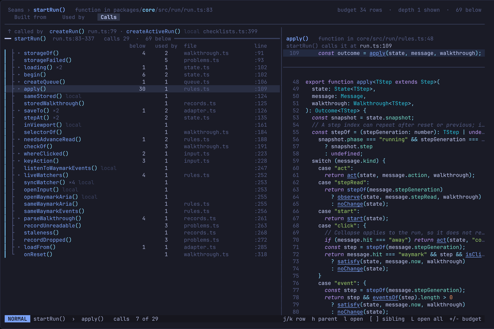
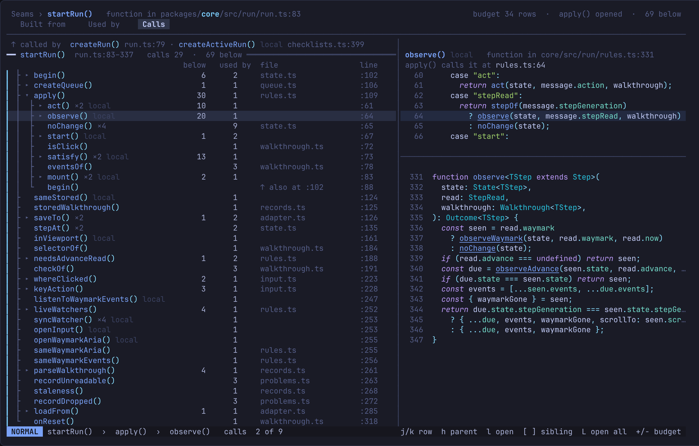
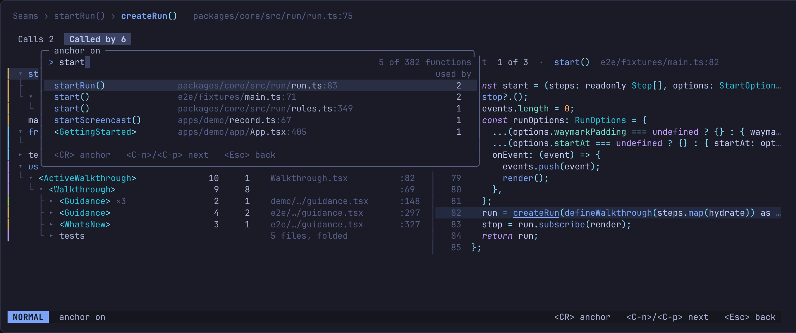
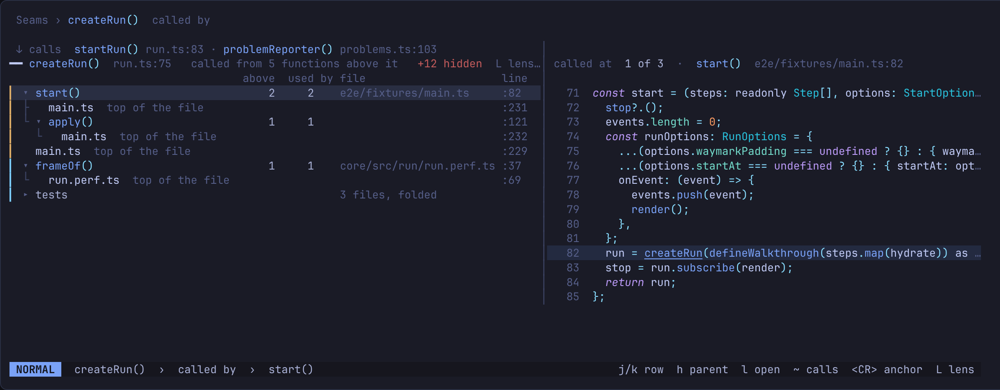
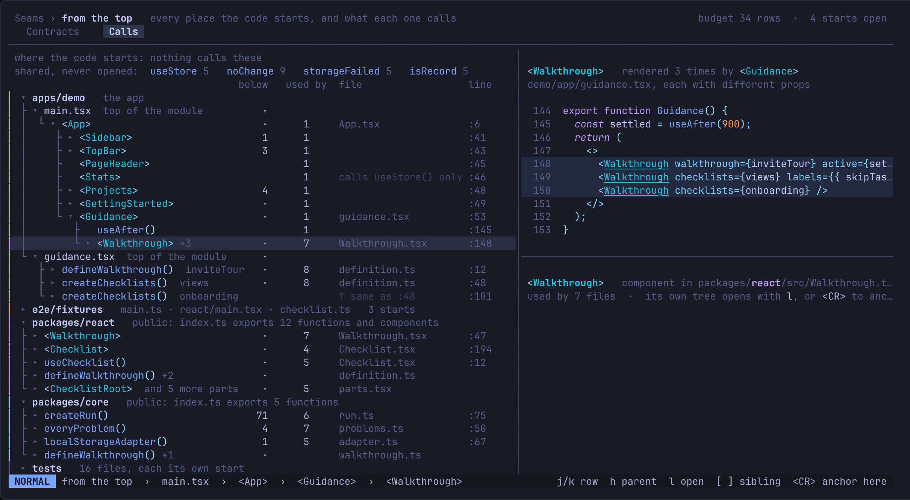
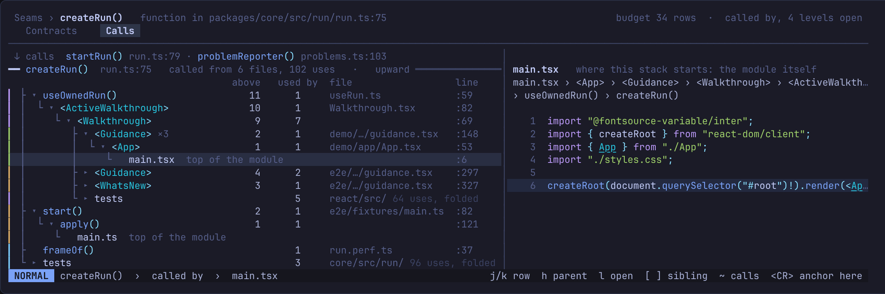

# Calls

The call tree of any function or component: everything it calls, all the way
down, or everything that calls it, all the way up. With no anchor, the tree
starts where the code starts, from what nothing calls.

Drawn 2026-10-26, not locked yet: it is being built to see how it goes.

## One tree, three ways in

It is one outline, the way a browser's devtools draw the DOM: a row per
function, two spaces a level, the code of the row under the cursor in a pane
on the right. The code is never inline.

The pane shows one of two views, swapped with `<Tab>` as a page swaps its
tabs. The choice stays while the cursor moves through the tree, and across
anchors and `<BS>`.

- **Called at.** Every place in the repo the row's function is called: each
  caller and each line, a caller calling it twice two places, the tests'
  after the rest. One at a time, as Used by draws a use: the caller's
  function, 20 rows at most, the call lit and the name underlined. It opens
  on the call the tree is about, the one its parent makes going down; going
  up, where the row is the caller, on the first place. `n` `N` step
  through them, round the ends. The head says where:
  `called at  4 of 100  ·  useOwnedRun()  useRun.ts:59`.
- **Itself.** Its own declaration, every call in it underlined. `n` `N`
  light the lines that call something, one after another. Going up, its call
  to the row above stands out, lit to start with.

A row nothing calls (a start from the top, a file's top) shows itself,
whatever was chosen, and says nothing calls it. Folders, files and the tests
row show where they are.

- **Anchored, calls.** `c` on a contract in the explorer. The anchor is pinned
  at the top, with one line for who calls it. Under it, what it calls in the
  order it is written, then what those call, and so on down.
- **Anchored, called by.** `~` flips the direction on the same anchor. The
  anchor stays pinned at the top, its callers indented under it, then their
  callers, and so on. What says it is the other way: the head reads
  `createRun()  called by`, the pinned line names what it calls
  (`↓ calls startRun() run.ts:83 · …`) where calls names who calls it, and
  the count column is **above** instead of **below**.
- **From the top.** `C`, in the explorer or on any anchor; the head reads
  `where the code starts`. The roots are
  what nothing calls: an app's entry file, a module's top-level code, a
  package's public functions no one in the repo calls, test files. They sit
  in the file tree, under their packages, so the top of the codebase reads by
  where it lives.

`<CR>` anchors on any row, in any of the three. `K` or `<BS>` goes back to
the previous anchor, and from the first one back to the explorer; `-` goes
straight there. `J` opens the page of the row's function, and `K` on it
comes back to the tree as it was.

## Anchor on anything

`/` in the tree opens a float over it titled `anchor on`: a prompt,
`> query`, with `5 of 382 functions` on its right, and under it every
function, component and class in the repo, no file's top and no test, those
the lens hides in its contracts column left out. Empty, the most used come
first, then by name. Typing narrows them with Neovim's own fuzzy match, the
best match first and the letters it matched underlined. A row is the name
as the tree draws it, then where it is, `packages/core/src/run/` dim,
`run.ts`, `:83` dim, then its used by under that column's title.

`<C-n>` `<C-p>` (or `<Down>` `<Up>`) move, `<CR>` anchors on it the way the
tree reads (from the top, calls) as `<CR>` on a row does, so `K` comes back;
`<Esc>` closes it with nothing changed. The status line reads `anchor on`
and the keys. In the code beside the tree `/` stays Vim's search.

## What a row says

Four columns after the name, in this order:

- **below**: how many functions sit under it, each counted once however many
  paths reach it. Called by shows **above** instead.
- **used by**: how many functions call it.
- **file**: only when it is not the file of the row above it.
- **line**: where the row above calls it. A root shows where it is declared.

A function already open higher in the tree is not opened twice: its row says
`↑ also at :102`, the line it was first opened from. A cycle ends the same
way.

## Taming it

- **A budget.** The tree opens level by level until the next level would not
  fit in the window. Everything past it is folded, with its count. You open
  more instead of folding less.
- **Shared functions are never opened for you.** One called from 5 or more
  functions (the threshold is a guess) is a utility: it shows as a row with
  its counts but the budget skips it. A pinned line lists the ones in view:
  `shared, never opened: useStore 5 · noChange 9`. `l` still opens one.
- **Tests fold to one row** among callers and roots: `tests  16 files`. `l`
  opens it.
- **The lens** is read the way the tree goes: what a function calls follows
  its **built from** column, what calls it its **used by** column, and the
  starts from the top its **contracts** column. The counts go by the same
  columns. What it hides is left out, with no row for it. It is never dropped
  in silence: the anchor's line counts the distinct functions the tree would
  hold without the lens and does not with it:
  `━ createRun()  run.ts:75   called by 6 · 9 above   +17 hidden  L lens`.
  From the top the head carries it:
  `where the code starts   +308 hidden  L lens`. The count is muted red,
  `L lens` grey, and nothing shows when the lens hides nothing.

## Keys

| Key | Does |
|---|---|
| `j` `k` | the next or previous row |
| `l` | open the row one level; on an open row, its first child |
| `h` | fold an open row, a folder or file too; on a folded or empty one, its parent |
| `O` | open everything under the row until the budget runs out |
| `H` | fold back to what the budget opened |
| `]` `[` | the next or previous sibling |
| `<CR>` | anchor on the row |
| `/` | anchor on any function: a float, typed to narrow, `<CR>` anchors, `<Esc>` back |
| `~` | flip: calls, called by |
| `J` | the page of the row's function, when it is a contract |
| `K` `<BS>` | the previous anchor; from the first, the explorer |
| `-` | straight to the explorer, on the anchor |
| `C` | from the top |
| `L` | the lens; closed, the tree redraws with it, as it was, the count of what it hides on the anchor's line |
| `<Tab>` | the code beside: called at, itself |
| `n` `N` | called at: the next or previous place; itself: the next or previous call. In the code, `]]` `[[` |
| `gd` | the declaration, in a normal window |
| `q` | close |

## Where it comes from

Treesitter alone, the same pass that finds built from. Every top-level
declaration, exported or not, gets its built-from names. Top-level statements
outside any declaration belong to the file as one node, `top of the file`. A
name counts as a call when it resolves to a function or component; types and
constants are left out.

## Not yet

- **Types.** A type's tree would be who it is handed to, with who makes it and
  who holds it pinned on top (`mocks/src/calls/tree.py`, tree-3). Unsure
  whether it reads; it waits.
- **What it can't follow.** A method on an interface, a prop or a callback
  ends the tree without saying so. It should say `✕ can't follow` rather than
  look like a leaf.
- **Test names.** A test file is one node; its `it()` names would say which
  test calls what.

The mocks are throwaway: `mocks/src/calls/tree.py` and `top.py`, with `lib.py`
and `graphq.py` beside them; the lens ones `mocks/src/lens/`.
