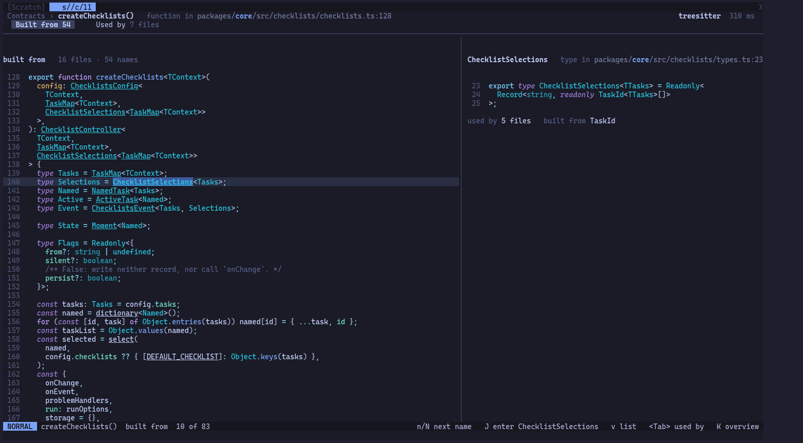
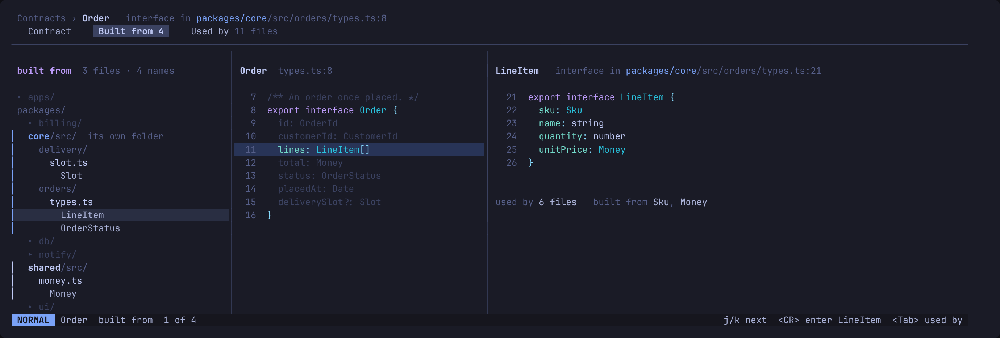
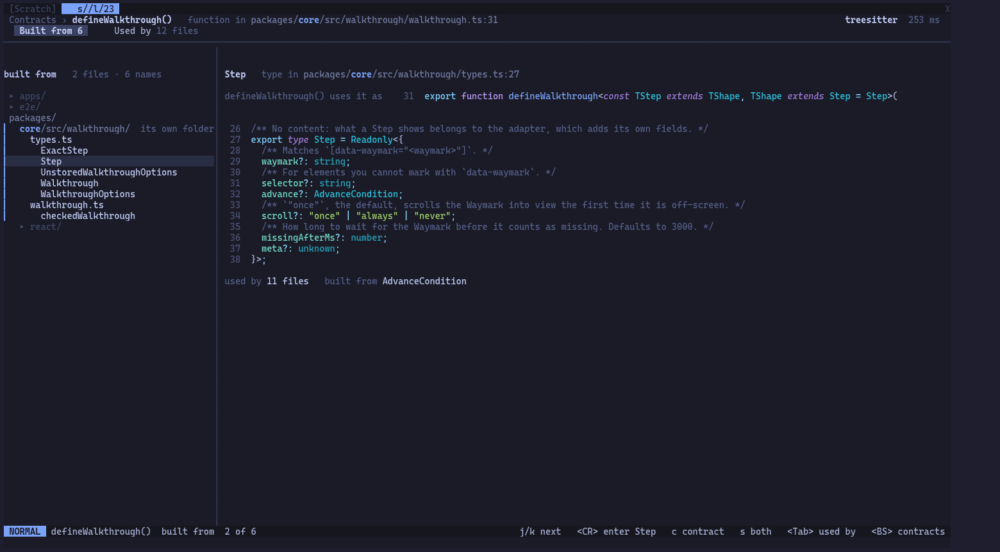
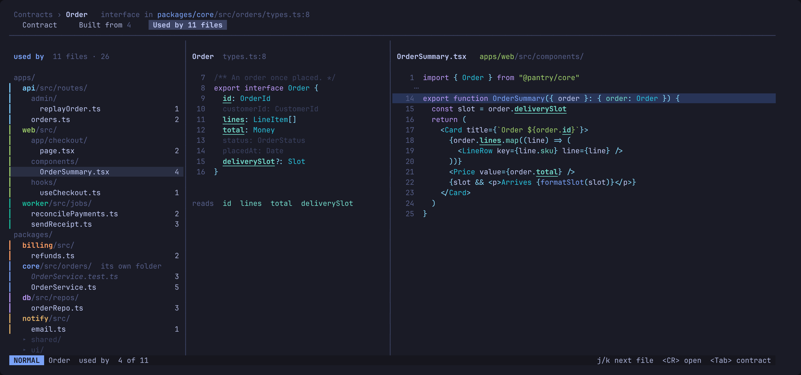
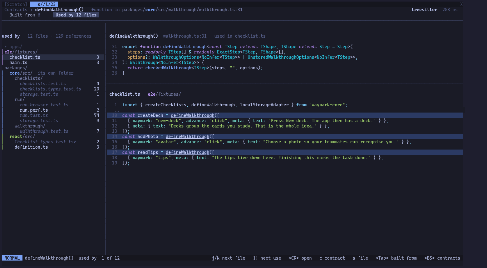

# A contract's page

`<CR>` on a contract in the explorer opens its page, full screen. The header
names it, its kind and `path:line`, with a crumb back (`K` or `<BS>`). Under it two
tabs, Built from and Used by, `<Tab>` between them. It opens on Built from,
or on Used by when the explorer shows only used by or the contract is built
from nothing.

Locked 2026-10-25, revised the same day. A change to it starts with a new
mock. The mocks are shots of the lab on a real repo.

## One seam at a time

Both tabs share one shape: the list down the left, and on the right the one
seam under the cursor. `j`/`k` step through them. Showing every dependency or
use at once was tried and was hard to read: four declarations side by side
say nothing about which one you are looking at.

The right side stacks the seam and this contract, a rule between them, in
the direction things flow. What it is built from sits above it; what uses it
sits below it. The contract's head says how they meet (`uses Step`, `used in
main.ts`).

`c` shows only the contract and `s` only the seam; the same key again shows
both, as `b` and `u` do in the explorer. Each tab keeps its own choice.

### Built from

It opens as code: the contract down the left, every name it is built from
underlined where it stands, a dashed line under one nothing resolves. The
cursor moves through it as through any code. The name it is on, or the
nearest on its line, is lit, and its declaration fills the right; on a line
naming none, the last one stays. `n` and `N` go to the next or previous name.
`J` or `<CR>` enters its page. Read top to bottom, the function says what each
piece is as you reach it, which a list of 50 names sorted by file did not.

`v` turns it into the list, on the same name, and back.

As a list, the left lists what it draws on. Above, the one under the cursor: its
declaration in full, with how many files use it and what it is built from.
Below, this contract, sized to fit, its unrelated lines dimmed and the line
naming the dependency lit. `J` or `<CR>` enters the dependency's page.

With the contract hidden (`s`), the dependency keeps the relation as one line
under its title: `defineWalkthrough() uses it as  31  export function …`.

### Used by

The left lists the files that use it. The right is the one file: its import
of the contract, then each use in the function it sits in, the line naming
the contract lit and every field it reads underlined. It opens with the file
alone; `c` brings the contract back above it, with the same fields
underlined, so what this file depends on reads straight down.

## The lens

Each list says what the lens hides from it as the explorer does,
`+3 hidden  L lens` in muted red, on the empty line under its title: the
list is too narrow for it beside the title. No row for what it hides
(`mocks/lens-explorer.png`).

## Settled

- Import lines are not uses: they are left out of the counts. Used by shows a
  file's import of the contract as its first line, because the path it comes
  through (`@pantry/core`, `import type`) says something.
- There is no Contract tab. The contract is always one key away beside the
  seam, and a page of it alone said less than either seam does.
- A class's members are its public fields and methods. A function has none.
- Used by groups by file. Grouping by member is not in v1.
- A file that uses the contract in many functions shows each function, 20
  rows at most, and the pane scrolls. `]]` and `[[` step between uses.
