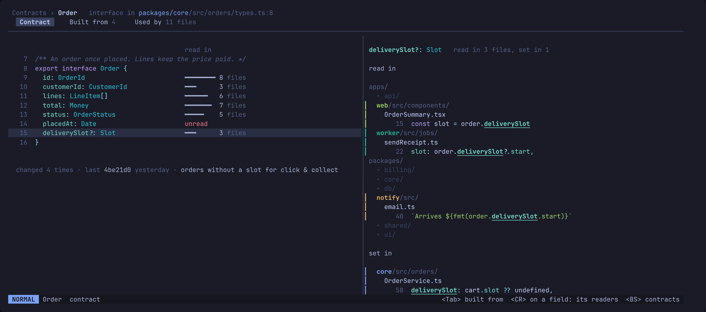
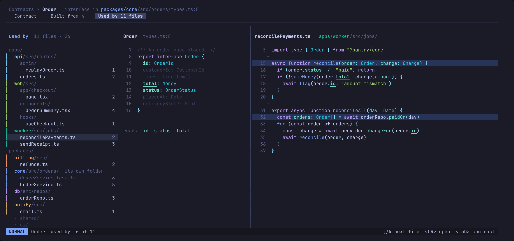

# A contract's page

`<CR>` on a contract in the explorer opens its page, full screen. The header
names it, its kind and `path:line`, with a crumb back (`<BS>`). Under it three
tabs, `<Tab>` between them, each with the whole screen.

Locked 2026-10-25. A change to it starts with a new mock.

## Contract

The whole declaration, highlighted as code, with its doc comment. Beside each
field or member, how many files read it: `textDocument/references` on the
member. A field no one reads says so.

The cursor on a field fills the right side: the files that read it, as a tree
with each line that reads it under its file, then where it is set. Reads and
writes are told apart by treesitter (the node a reference sits in).

Below the declaration, from git: how often it changed, the last commit and
its message.

## One seam at a time

Built from and Used by share one shape: the list down the left, this
contract in the middle, and on the right only the one seam under the cursor.
`j`/`k` step through them. Showing every dependency or use at once was tried
and was hard to read: four declarations side by side say nothing about which
one you are looking at.

The middle is always this contract's declaration, its unrelated lines dimmed,
so you see which part of it the seam touches.

### Built from

The left lists what it draws on. The middle lights the line that uses the one
under the cursor (`lines: LineItem[]`). The right is its declaration in full,
with how many files use it and what it is built from. `<CR>` enters its page.

### Used by

The left lists the files that use it. The right is the one file: its import
of the contract, then each use in the function it sits in, the line naming
the contract lit and every field it reads underlined. The middle underlines
the same fields, so what this file depends on reads straight across.

## Settled

- Import lines are not uses: they are left out of the counts. Used by shows a
  file's import of the contract as its first line, because the path it comes
  through (`@pantry/core`, `import type`) says something.
- A class's members are its public fields and methods. The count beside a
  method is the files that call it.
- A function has no members. On its Contract tab the right side lists its
  calls, one line each, under their files.
- Used by groups by file. Grouping by member is not in v1.
- A file that uses the contract in many functions shows each function, 20
  rows at most, and the pane scrolls. `]]` and `[[` step between uses.
