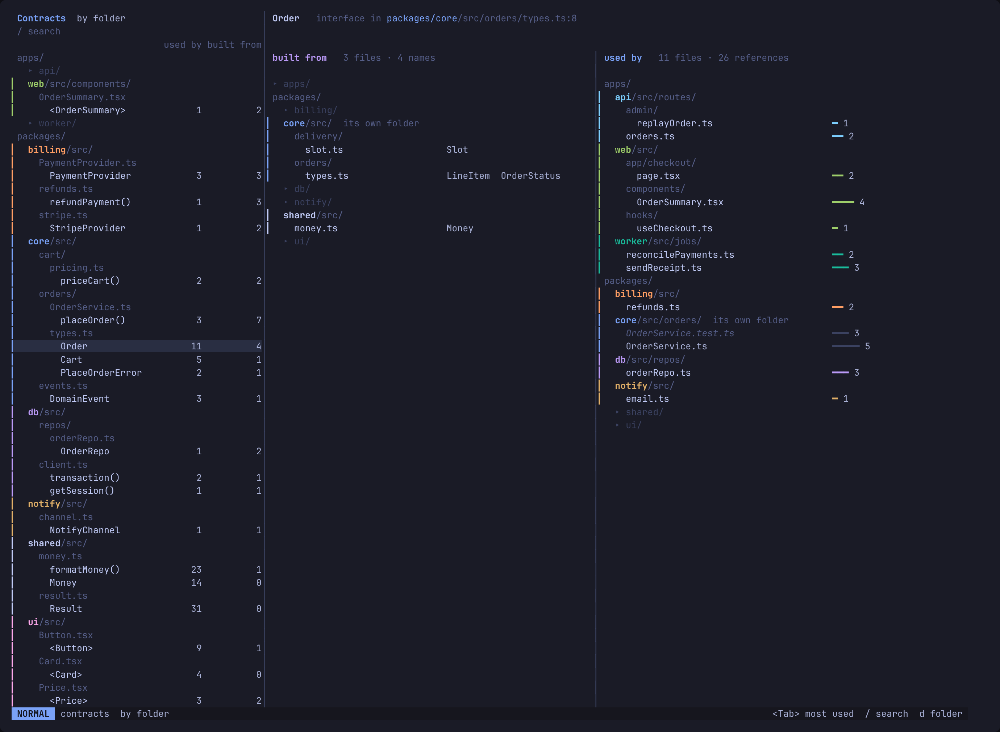
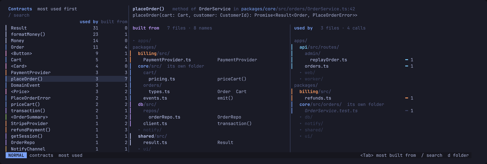
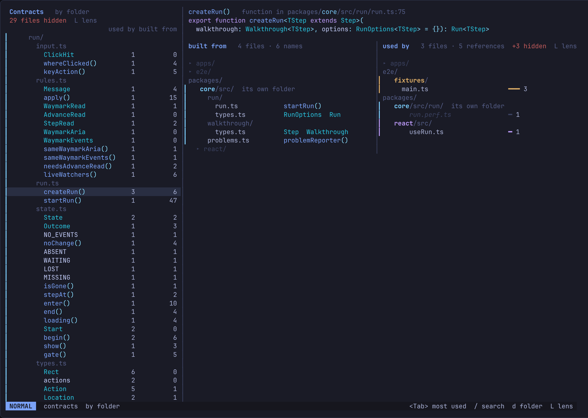

# The explorer

A full-screen view of every contract, the first thing `:Seam` opens.

Locked 2026-10-25. A change to it starts with a new mock.

## What a contract is

An export used outside its own file. Its users come from
`textDocument/references`, its signature from hover. What it is built from:
treesitter collects the identifiers in its declaration, then
`textDocument/definition` for each. Barrel files resolve to the original
declaration.

## Three columns

- **Contracts**, on the left, narrow (46 columns). Each contract with two
  counts: used by (references) and built from (names it draws on).
- **Built from**, in the middle. The files the contract under the cursor
  draws on, each with the names it takes from them.
- **Used by**, on the right. The files that reference it, each with a bar
  and a count of references.

The cursor on a contract redraws both trees. A header across them names the
contract, its kind and `path:line`, and its declaration in its own colours,
wrapped and cut to two rows. Beside one tree alone it takes five. Names in the built from tree take their
declarations' colours and the tree's full width, wrapped under the file to
two rows, five when built from is alone, then cut with `…`.

## The trees

All three are trees, drawn the way thread's files column draws them: two
spaces a level, directories end in `/`, a chain of lone directories is one
row (`web/src/components/`), files by their name. In the left one each
contract sits under its file.

Every package is always there, so the skeleton holds while the cursor moves.
A package the contract does not touch is one dim row, `▸ db/`. Directories
before files, each sorted by name.

## Orders

`<Tab>` steps through them: by folder (the default, the tree), most used,
most built from. They are ways of ordering one list, not modes. The header
names none of them: the tree shows by folder, and the count sorted by is lit.

## Colour

One meaning per colour. Each package has a hue, and that hue is the only
one on the screen:

- the package's name in its tree row (the rest of the path stays grey),
- a thin bar `▎` down the left of every row inside it, in all three columns,
- the used-by bars.

So where a contract's users live reads from the colours alone. The
contract's own package and tests are dimmed, so the bright rows are the uses
that cross a boundary. `packages/shared` is left uncoloured: the place
everything uses is the neutral one.

Kind shows in the name's shape, from the LSP's SymbolKind: `fn()`,
`<Component>`, `Type`. A name is coloured as its declaration is in the
editor, from its line's treesitter captures: a type as a type, a function as a
function, `UPPER_CASE` as a constant, a plain `const` plain. Colouring by kind
was dropped once, because the code colours reuse the package hues and a blue
function read as "lives in core". It came back on 2026-10-26: telling a type
from a function at a glance was worth more. The clash stands: an orange
package holds orange constants.

## The lens

The lens (`L`) hides files per column. Each column it took something from
says so on a line it already has, with one count however many rules there
are, and `L lens` after it, the key that lists the rules:

- **Contracts**: on the line under its title, `29 files hidden  L lens`, the
  files whose contracts it leaves out.
- **Built from** and **used by**: on the title, the files it leaves out of
  the tree: `used by   3 files · 5 references   +3 hidden  L lens`.

The count is a muted red, apart from the pink package hue; `L lens` is grey.
A column the lens takes nothing from says nothing. So that a lens on is never
out of mind, the status line's last word on every screen, the explorer, a
page and the call tree, is `L lens 2`, the rules on, in the same red; with
none it is the grey `L lens` among the other keys. Nothing hidden gets a row:
the screen never lists the rules or what they hid, the panel does. The mock's
source is `mocks/src/lens/`.

## Rejected along the way

Matrices and DSM grids, footprint strips, glyph columns that need a legend,
a whole-system map (does not scale in Neovim), stacking the two trees (a long
one hides the other), sort words in a row, LLM commentary. The rule that
came out of it: nothing that needs a legend.

## Settled

- Hues go to eight packages, in the order they are first seen, and are stored
  so they don't move. Past eight, packages are grey.
- Strict nesting: a file with one contract still has its own row.
- Counts come from a background pass over a cache, so the list opens at once
  and fills in. An unknown count shows `·`.
- `d` on a directory row filters to it: the list shows only the contracts in
  it, and the two trees only the users and dependencies in it. `D` clears it.
- Under 150 columns is not designed.

The mocks are throwaway: `mocks/src/page7.py` (needs `gen.py`, `page6.py`,
`base.css` beside it). The codebase in them, Pantry, is made up:
`mocks/src/codebase.md`.
