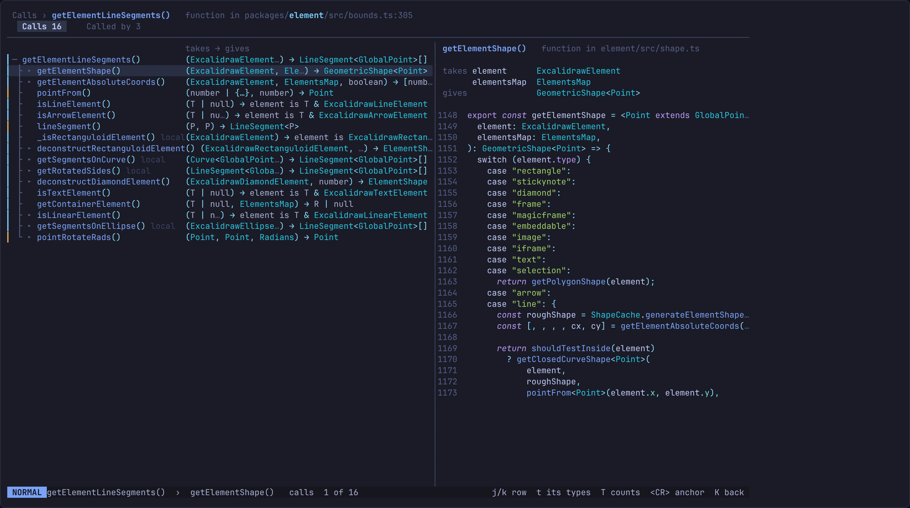
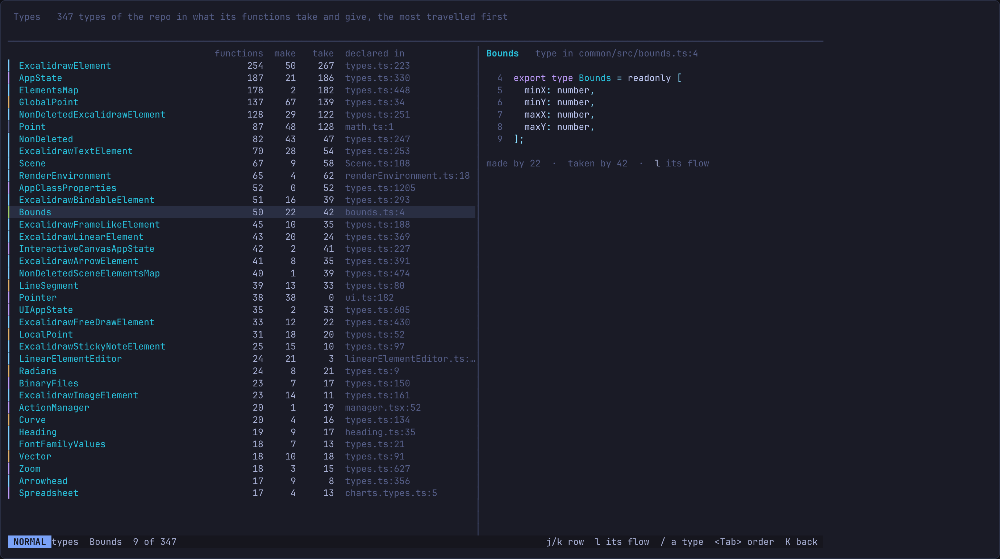
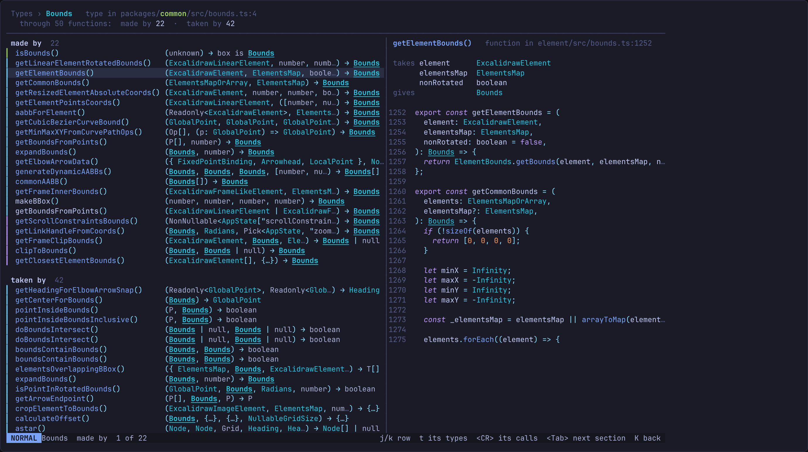

# Types

The codebase read through its data. Every function says what it takes and
what it gives, and every type of the repo shows the functions that make it
and the ones that take it. The question it exists to answer: is following the
data the fastest way into a codebase?

Drawn 2026-10-27 from the lab's excalidraw copy, real data. Not locked: it is
being built to see how it goes.

## Where the types come from

The TypeScript server, once per callable: `textDocument/hover` on the name of
each function, component and class in the call graph. The hover is the
server's own type, inferred where the code writes none. In excalidraw 15% of
functions write a return type, and the server answered all 2151 callables
(measured, tsgo 7.0.0-dev, 11 to 30 s in the background).

`scripts/types.lua` writes the hovers as they came, beside the treesitter
index, as `types.json`. It also writes which calls of a class are `new`:
the source just before the call says so. `seam.types` parses each hover into
its parameters and return, and builds each repo type's flow.

- **A repo type.** An exported interface, type alias, class or enum, by
  name. Two declared with one name are one type, `×2` in the list.
- **Takes it.** A parameter's type names it anywhere: `Bounds`,
  `Bounds[]`, `NonDeleted<Bounds>`, `{ bounds: Bounds }`.
- **Makes it.** The return type names it, or the function says `new` to
  its class.

In excalidraw, 1241 of 2151 callables take or make a repo type, and 347
types flow through at least one function (measured).

## Calls, typed

The call tree as it is, with what each row's function takes and gives where
the counts were: `(ExcalidrawElement, ElementsMap) → GeometricShape<Point>`.
Read down the tree, the data changes shape from one call to the next.

- Repo types are in the type colour, everything else dim.
- An object type written inline is shortened to the repo types it names,
  `{ AppState, Scene }`, or `{…}` naming none.
- Too long, what it takes is cut first: `(ExcalidrawElement, Ele…) →
  GeometricShape<Point>`. The return is kept whole as long as it can be.
- `T` swaps back to the counts (below, used by, file, line), and again to
  the types. The types are the default once a repo has them.

The code beside it says the same at full length under its head, one
parameter a line: `takes element ExcalidrawElement`, then `gives`.

Under that, the pane has a third view, **Types**, first of `<Tab>`'s three
and the one it opens on once a repo has types: the declaration of every repo
type the function takes and gives, as written, in the order its signature
names them, each headed `takes`, `gives` or `both`. So the row says
`(State, Message, Walkthrough) → Outcome` and the pane shows what a `State`
and an `Outcome` are, field by field. A declaration longer than 40 lines
stops there, and `gf` reads the rest.

## The types

`T` in the explorer. Every repo type that flows through a function, the
most travelled first: how many functions, how many make it, how many take
it, and where it is declared. The pane on the right is the declaration of
the type under the cursor, its shape.

## One type's flow

`l` or `<CR>` on a type, `t` on a type's contract in the explorer or on its
page, or `t` on a function's row anywhere: the types it takes and gives,
one straight to its flow, several in the `/` float.

Two sections, read top to bottom as the data goes: **made by**, then
**taken by**. A row is a function with its signature, the type lit where it
appears. `new` marks one that makes it with `new`. The pane on the right is
the function under the cursor with its takes and gives, the type underlined
in its code.

From a row, `t` goes on to one of its other types and `<CR>` anchors the
call tree on it. `K` comes back each time. So the walk is type, function,
type: what makes a `Bounds`, what that one takes, what makes that.

## Keys

| Key | Where | Does |
|---|---|---|
| `T` | explorer | the types, the most travelled first |
| `T` | calls | the tree's columns: types, counts |
| `t` | explorer, page | the flow of the contract shown, when it is a type |
| `t` | calls, a flow | the types of the row's function: one, its flow; several, the `/` float |
| `l` `<CR>` | the types | that type's flow |
| `<CR>` | a flow | the call tree on the row's function |
| `<Tab>` | a flow | the next section: made by, taken by |
| `/` | the types, a flow | another type, in a float, the most travelled first |
| `K` `<BS>` | | back |

## Not yet

- The lens: the types and flows are not filtered by it.
- Types that are not exported, and members: a field of `AppState` used on
  its own is not followed.
- A function's body: which fields of what it takes it reads, and what it
  builds on the way. That is the next question, after this one is answered.
